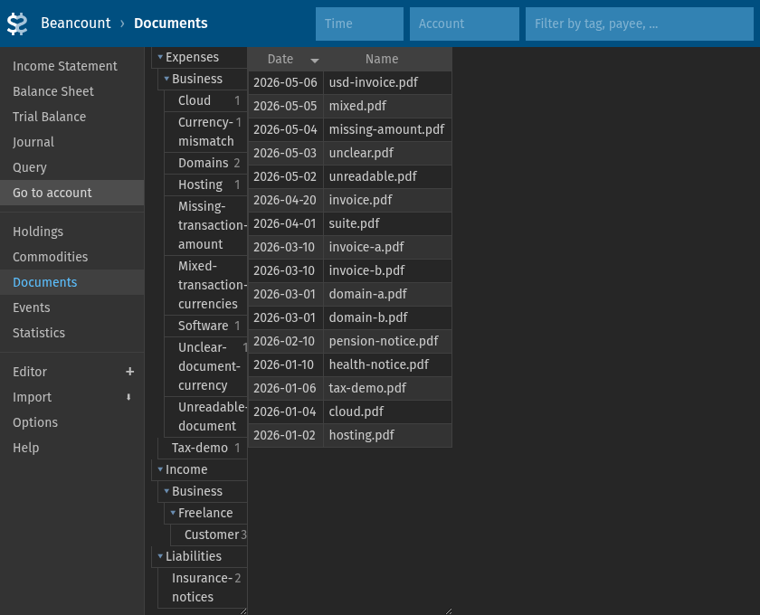

# hledger-document-check

`hledger-document-check` checks hledger transactions against documents on disk.

## Audience

This tool is for anyone who wants to do a document check or voucher audit against
an hledger journal. That can be useful for tax declarations, where relevant
transactions should be backed by filed documents.

The tool supports documents for invoices received and invoices sent to
customers. It can also check whether invoice/document amounts plausibly match the
connected ledger transactions.

## Installation

Required tools:

- [`hledger`](https://hledger.org/) 1.52.1

Optional:

- [`fava`](https://beancount.github.io/fava/) for the example Fava workflow

Download the standalone executable for your platform from the
[latest release](https://github.com/roschaefer/hledger-document-check/releases/tag/latest)
and put it on `PATH`:

```bash
curl -L \
  -o /tmp/hledger-document-check \
  https://github.com/roschaefer/hledger-document-check/releases/download/latest/hledger-document-check-linux-x86_64
install -m 0755 /tmp/hledger-document-check ~/.local/bin/hledger-document-check
```

For macOS on Apple Silicon, use the `hledger-document-check-macos-arm64` asset
instead.

## Usage

### Use it with your own journal and documents

Run the document check against your document folder. If your document folder has
a `hledger-document-check.toml` with a configured journal path, `--documents` is
enough:

```bash
hledger-document-check check --documents path/to/documents
```

Otherwise, pass the journal explicitly:

```bash
hledger-document-check check --journal path/to/hledger.journal --documents path/to/documents
```

To emit a derived journal with `document:` tags, run:

```bash
hledger-document-check enrich-journal --journal path/to/hledger.journal --documents path/to/documents
```

### Run the bundled example

The repository includes a complete example project under `example/`. Run the
document check against it:

```bash
hledger-document-check check --documents example/documents --today 2026-05-20
```

To generate a Beancount file and open it in Fava (requires `hledger` and
`fava` on `PATH`):

```bash
example/rebuild-fava-inputs.sh
hledger-document-check enrich-journal \
  --journal example/journal.journal \
  --documents example/documents \
  --document-tag-root "$(pwd)/example/.generated/fava/documents" \
  | hledger -f - print -O beancount >> example/.generated/fava/example.beancount
fava example/.generated/fava/example.beancount
```

## Full Example

The complete command output is kept executable in the [full-example Scrut specification](tests/specifications/full-example/).

The Fava example uses `enrich-journal` to add `document:` tags, then converts
the journal to Beancount so Fava can browse transactions together with their
linked PDFs.



Because Fava reads Beancount, account names used with this workflow must follow
Beancount naming conventions. The bundled example uses capitalized account
components such as `Expenses:Business:Hosting`.

The Fava workflow is exercised by the [full-example Scrut specification](tests/specifications/full-example/#the-generated-fava-project-exposes-linked-documents).

## Specification By Example

Executable [Scrut](https://github.com/facebookincubator/scrut) specifications live in [`tests/specifications/`](./tests/specifications/). Run them with `just test-scrut` inside the Nix development shell.

Specs:

- [Contract](./tests/specifications/contract/)
- [Configuration](./tests/specifications/configuration/)
- [Directory and file layout](./tests/specifications/directory-and-file-layout/)
- [Special cases with `.document.yml`](./tests/specifications/document-metadata/)
- [Amount audit](./tests/specifications/amount-audit/)
- [Unbooked invoices](./tests/specifications/unbooked-invoices/)
- [Due date](./tests/specifications/due-date/)
- [Enrich journal](./tests/specifications/enrich-journal/)
- [Full example](./tests/specifications/full-example/)

## Development

Enter the reproducible development shell, which includes Rust, `hledger`,
Just, Scrut, and the linting tools:

```bash
nix develop
```

Alternatively, install a [Rust toolchain](https://rustup.rs/),
[`hledger`](https://hledger.org/),
[Just](https://github.com/casey/just), and
[Scrut](https://github.com/facebookincubator/scrut) yourself.

Clone the repository and build:

```bash
git clone git@github.com:roschaefer/hledger-document-check.git
cd hledger-document-check
cargo build --release
# binary is at target/release/hledger-document-check
```

Run the Rust tests:

```bash
just test
```

## Core Concepts

- Account folders mirror ledger accounts, for example
  `Expenses:Business:Hosting` maps to `documents/Expenses/Business/Hosting/`.
- Matched document files start with `YYYY-MM-DD-`.
- Unbooked documents live in an account-local `unbooked/` subfolder.
- Supporting files live in a sibling directory named after the document stem.
- `*.document.yml` sidecars describe non-trivial relationships, due dates, and
  amount metadata.
- `document_check:` account and posting tags decide which transactions require
  document coverage.
- `hledger-document-check enrich-journal` emits a derived journal with `document:` tags for downstream
  tools such as Fava.

## Check Policy Reference

Checks can be configured as `fail`, `warn`, or `ignore` through CLI flags or the
`[checks]` table in `hledger-document-check.toml`.

Built-in check names:

- `invalid-configuration`
- `missing-document-coverage`
- `unbooked-documents`
- `overdue-unbooked-documents`
- `unmatched-documents`
- `unexpected-files`
- `duplicate-files`
- `amount-mismatches`
- `amount-audit-skips`
- `missing-document-placeholders`
- `ambiguous-transaction-groups`
- `redundant-metadata`
- `unresolvable-cover-metadata`

## Configuration

Project defaults can live in `hledger-document-check.toml` inside the document
root:

The generated file is covered by the [configuration Scrut specification](tests/specifications/configuration/#the-readme-command-generates-the-initial-config-file).

With that file in place, the normal command can be short:

```bash
hledger-document-check check --documents path/to/documents
```
